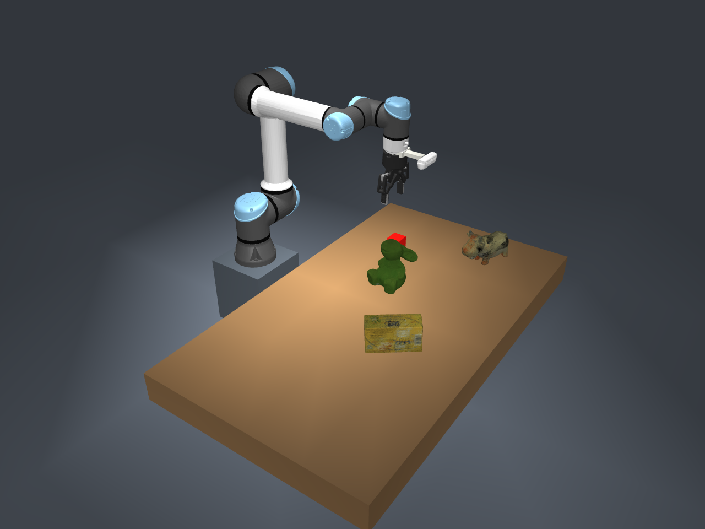
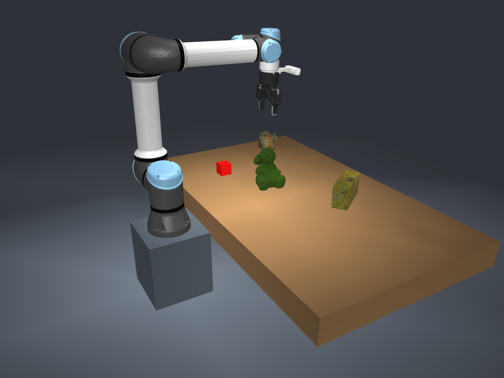
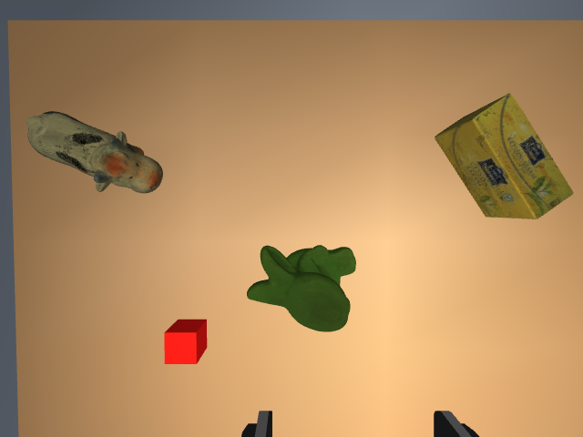
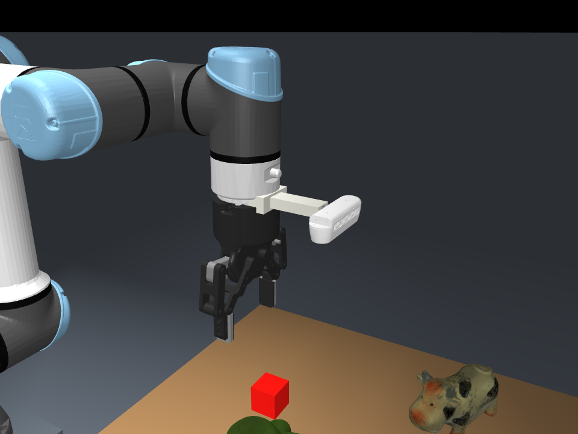
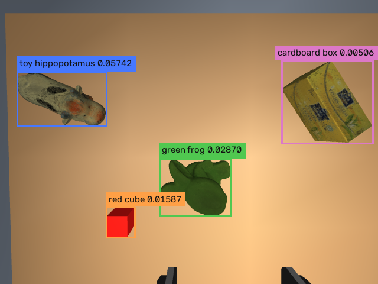
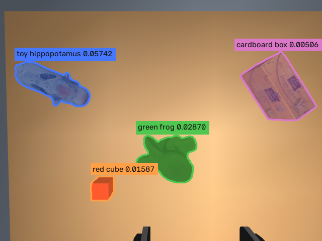
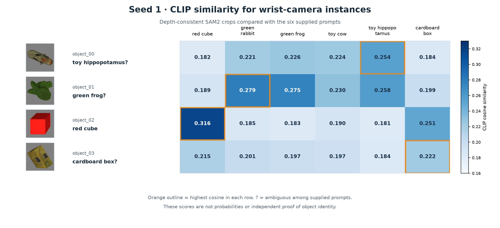
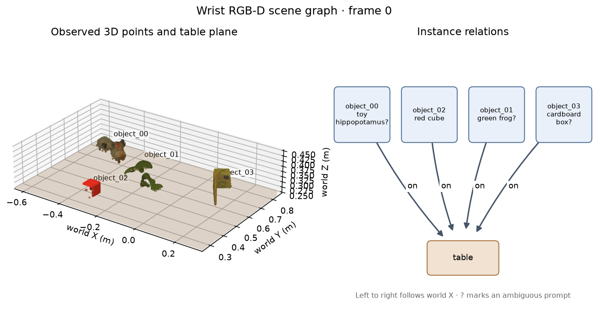

# UR5e tabletop RGB-D sandbox

This project runs a UR5e with a Robotiq 2F-85 gripper and a side-mounted RealSense D435i in MuJoCo. The camera looks along the gripper approach axis. A red cube and two or three HomebrewedDB objects appear on the table with their original colors.

## Preview

<p align="center">
  
</p>
<p align="center"><sub>Seed 1 tabletop scene · cube plus three HomebrewedDB objects</sub></p>

<p align="center">
  <a href="docs/images/tabletop_seed1_alternate.png"></a>
  <a href="docs/images/eye_in_hand_seed1_rgb.png"></a>
  <a href="docs/images/ur5e_camera_mount_seed1.png"></a>
</p>
<p align="center"><sub>Second angle · wrist RGB · RealSense and gripper mount, all from seed 1</sub></p>

Object choice and placement are repeatable with a seed. The RealSense image is 640×480; the capture script also saves metric depth for every pixel.

## Layout

- `examples/ur5e_eye_in_hand/` — scene builder, interactive viewer, RGB-D capture, and optional ZMQ subscriber.
- `examples/open_vocab_pipeline/` — YOLO-World detection and SAM2 Tiny segmentation of wrist RGB frames.
- `examples/scene_graph/` — metric back-projection, wrist-to-world transforms, CLIP embeddings, and instance relations.
- `examples/action_primitives/` — Jacobian IK grasp, place, tabletop push, and drawer actions with simulated contact checks.
- `examples/maniskill3/` — a separate ManiSkill PickCube experiment.
- `thirdparty/mujoco_menagerie/` — only the UR5e, 2F-85, and D435i model assets used here.
- `thirdparty/maniskill3/` — ManiSkill 3.0.1 package source and bundled assets.
- `docs/images/` — tabletop scenes, camera views, and open-vocabulary results.
- `videos/ms3_benchmark/` — existing ManiSkill benchmark recordings.

The Docker image has separate Python environments: `/root/miniconda3/bin/python` for MuJoCo and `/root/miniconda3/envs/maniskill/bin/python` for ManiSkill 3.0.1. The ManiSkill example can load the source copy under `thirdparty/maniskill3` through `PYTHONPATH`.

## Run the UR5e scene

Start from this directory. The HomebrewedDB mount is read-only:

```bash
HB_ROOT='/media/rafay/Windows-SSD1/other/data/open_source/HB_HomebrewedDB_TUM'
XAUTH_FILE="${XAUTHORITY:-$HOME/.Xauthority}"
docker run -it --rm --name vla_scenegraph_env --gpus all --ipc=host --network=host \
  -e DISPLAY="$DISPLAY" -e XAUTHORITY=/tmp/.Xauthority \
  -e NVIDIA_DRIVER_CAPABILITIES=compute,utility,graphics,display \
  -v /tmp/.X11-unix:/tmp/.X11-unix -v "$XAUTH_FILE":/tmp/.Xauthority:ro \
  -v "$PWD":/workspace -v "$HB_ROOT":/datasets/homebrewed:ro \
  -w /workspace -d vla_scenegraph_env:v01
```

The Xauthority mount lets the container authenticate to the host X server for MuJoCo rendering. Drive mount names can change; update `HB_ROOT` and verify that `hb_models/models/models_info.json` exists beneath it. An empty directory produces the cube-only scene.

With the container running, open the scene or the live camera view:

```bash
docker exec -it vla_scenegraph_env /root/miniconda3/bin/python \
  /workspace/examples/ur5e_eye_in_hand/view.py --camera overview
docker exec -it vla_scenegraph_env /root/miniconda3/bin/python \
  /workspace/examples/ur5e_eye_in_hand/view.py --camera wrist
```

Capture one 640×480 RGB-D frame:

```bash
docker exec vla_scenegraph_env /root/miniconda3/bin/python \
  /workspace/examples/ur5e_eye_in_hand/run.py --frames 1 --seed 1 --hb-count 3
```

Generated frames and converted object meshes go under `outputs/`; this directory is disposable and can be regenerated from the read-only dataset. See [the example guide](examples/ur5e_eye_in_hand/README.md) for gripper controls, camera close-ups, and ZMQ streaming.

## Detect and segment objects in wrist frames

### Example output

These results use the same seed 1 wrist frame and the prompts `red cube`, `green rabbit`, `green frog`, `toy cow`, `toy hippopotamus`, and `cardboard box`. CLIP ViT-B/32 encodes prompt text for YOLO-World. The boxes show four retained proposals and their raw detector scores; a gripper proposal was filtered. The animal names are prompt-conditioned candidates, not verified object identities.

**YOLO-World: prompted detections**

<p align="center"><a href="docs/images/open_vocab_yolo_world_seed1.png"></a></p>

**SAM2 Tiny: masks from the detected boxes**

<p align="center"><a href="docs/images/open_vocab_sam2_seed1.png"></a></p>

**CLIP: a separate crop-to-text comparison**

<p align="center"><a href="docs/images/open_vocab_clip_seed1.png"></a></p>

The heatmap compares depth-consistent SAM2 instance crops with the same six prompts. It is a separate diagnostic, not YOLO-World confidence or a calibrated probability. For example, the `green frog` candidate scores almost equally against `green rabbit` and `green frog` in CLIP.

### Run it yourself

After capturing a frame, install the perception dependencies and run YOLO-World with text prompts followed by SAM2 Tiny box-prompted segmentation:

```bash
docker exec vla_scenegraph_env /root/miniconda3/bin/pip install \
  -r /workspace/examples/open_vocab_pipeline/requirements.txt
docker exec -it vla_scenegraph_env /root/miniconda3/bin/python \
  /workspace/examples/open_vocab_pipeline/run.py \
  --prompts "red cube, green rabbit, green frog, toy cow, toy hippopotamus, cardboard box" \
  --confidence 0.003 --output-dir /workspace/outputs/seed1_perception
```

See [the open-vocabulary example guide](examples/open_vocab_pipeline/README.md) for saved-frame, directory, and live ZMQ modes, plus the mask and JSON outputs.

## Build the 3D scene graph

After a **fresh** RGB-D capture and detection run, build a world-frame graph from the saved masks and depth:

```bash
docker exec vla_scenegraph_env /root/miniconda3/bin/python \
  /workspace/examples/scene_graph/run.py \
  --detections /workspace/outputs/seed1_perception/frame_0000_detections.json \
  --output-dir /workspace/outputs/seed1_graph
```

<p align="center"><a href="docs/images/scene_graph_seed1.png"></a></p>
<p align="center"><sub>Seed 1 · observed 3D surfaces, support edges, source-to-target directional relations and distances, and the planar <code>between</code> relation</sub></p>

The output includes per-instance 3D point clouds, observed bounds, a 512-value CLIP image embedding, prompt similarities, pairwise metric geometry, and spatial relations such as support, world-frame directions, and `between`. The graph checks RGB, depth, mask, and camera metadata fingerprints before projecting points. For `inside`, provide a calibrated container interior; the single wrist view cannot infer an unseen cavity reliably. Contact, attachment, occlusion, and action effects need additional evidence and are not asserted from this frame. See the [scene-graph guide](examples/scene_graph/README.md) for relation definitions, equations, output files, and limits, plus how the [EmbodimentSemantic benchmark](https://huggingface.co/datasets/SemVLA/EmbodimentSemantic) could be used for comparison.

## Run Phase 2 action primitives

The UR5e now has contact-checked Jacobian IK actions for grasping, placing, or pushing a graph node, plus pulling and closing an optional sliding drawer. Start with the repeatable cube and drawer fixtures:

```bash
docker exec vla_scenegraph_env /root/miniconda3/bin/python \
  /workspace/examples/action_primitives/run.py --action grasp-place
docker exec vla_scenegraph_env /root/miniconda3/bin/python \
  /workspace/examples/action_primitives/run.py --action pull-push \
  --output-dir /workspace/outputs/action_primitives/drawer_demo
```

The first demo labels its cube bounds as simulator fixture data. The [action-primitives guide](examples/action_primitives/README.md) shows the complete route from a fresh wrist RGB-D capture through YOLO-World, SAM2, and the 3D scene graph to `grasp(node_id)`. It also explains world-frame target regions, outcome files, and current limits.

Larger seed-1 objects exceed the current top-down 2F-85 grasp width. The guide includes tested `--action push` commands and a separate absolute world target for each seed-1 object. Capture a random HomebrewedDB scene once and keep its RGB-D, detection report, and graph paired: action replay reads the saved seed and object-count mode automatically. Repeated action runs receive a new numbered output directory so earlier videos remain available.

To **watch** the pick and the changing graph, add `--visualize`. The window shows a MuJoCo overview, the wrist camera, and live object relations; it also saves an MP4. `--native-viewer` opens a second, mouse-controlled 3D MuJoCo window. Add `--perception-checkpoints` to run YOLO-World, SAM2, and the observed scene-graph pipeline on frames saved before and after the action:

```bash
docker exec -it vla_scenegraph_env /root/miniconda3/bin/python \
  /workspace/examples/action_primitives/run.py --action grasp-place \
  --visualize --perception-checkpoints \
  --output-dir /workspace/outputs/action_primitives/live_pick
```

The live graph reads simulator poses and contacts and is labeled **simulator state**. The checkpoint graphs come from wrist RGB-D perception. The held cube can be outside the wrist camera's usable view even while the live graph shows it in the gripper; the guide explains this distinction and the saved files.

## Run the ManiSkill example

The bounded smoke check uses the ManiSkill environment and the vendored source:

```bash
docker exec -e PYTHONPATH=/workspace/thirdparty/maniskill3 vla_scenegraph_env \
  /root/miniconda3/envs/maniskill/bin/python \
  /workspace/examples/maniskill3/parallel_in_single_scene.py --num-envs 2 --steps 2
```

Add `--render --steps 0` for the interactive viewer. See [the ManiSkill example guide](examples/maniskill3/README.md).
