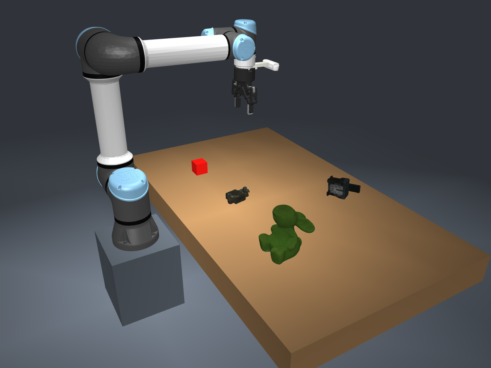
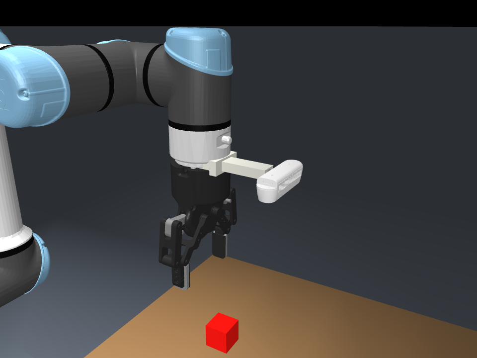
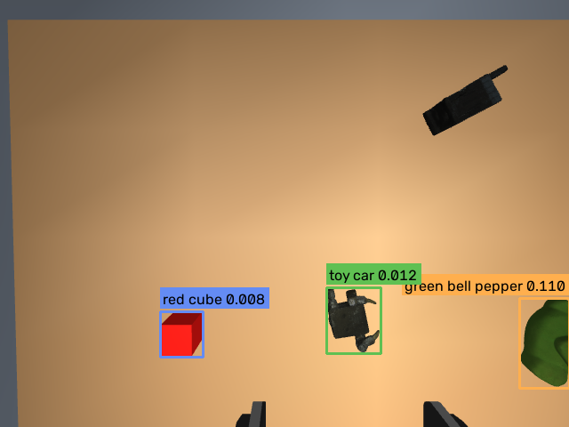
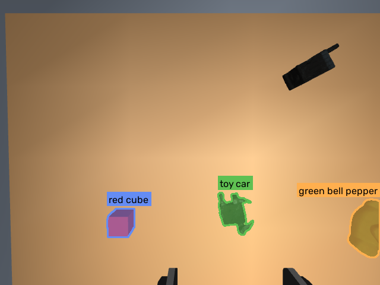
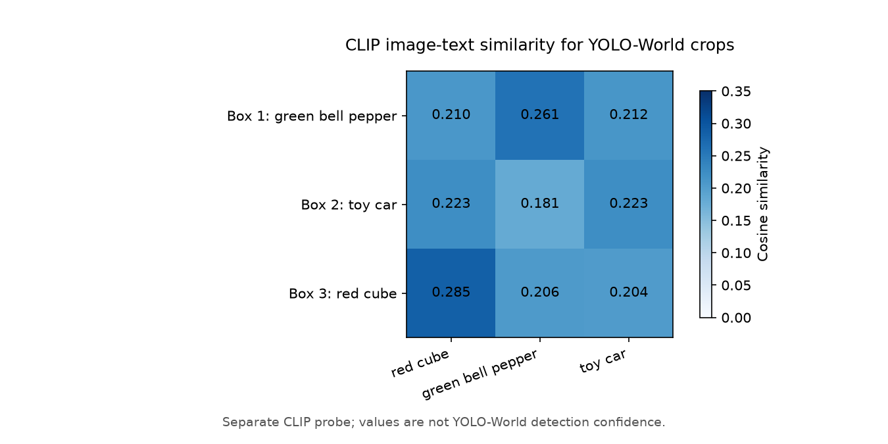
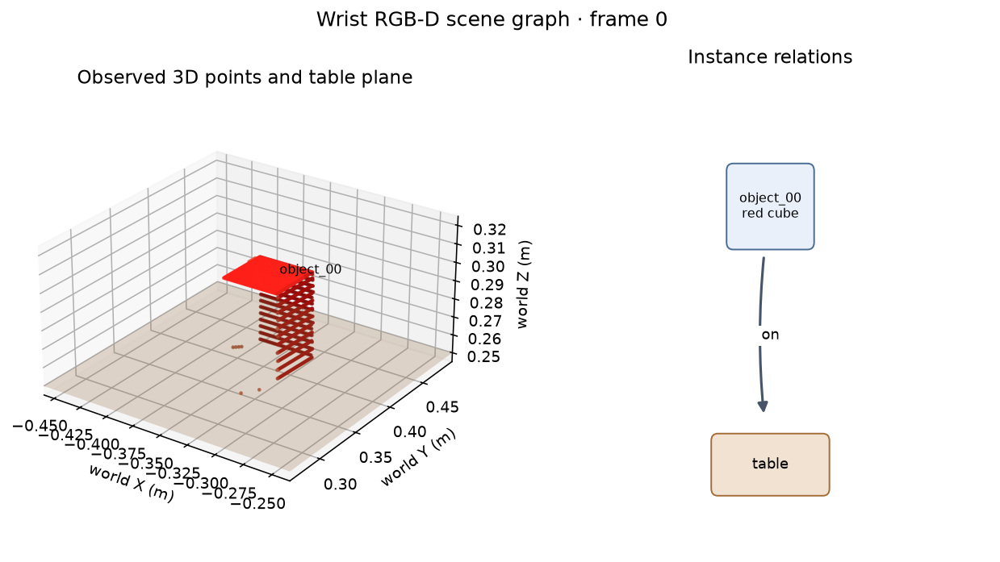

# UR5e tabletop RGB-D sandbox

This project runs a UR5e with a Robotiq 2F-85 gripper and a side-mounted RealSense D435i in MuJoCo. The camera looks along the gripper approach axis. A red cube and two or three HomebrewedDB objects appear on the table with their original colors.

## Preview

<p align="center">
  
</p>
<p align="center"><sub>Tabletop scene · seed 7 · three randomly selected objects plus the cube</sub></p>

<p align="center">
  <a href="docs/images/tabletop_seed_42.png"></a>
  <a href="docs/images/eye_in_hand_rgb.png"></a>
  <a href="docs/images/ur5e_camera_mount.png"></a>
</p>
<p align="center"><sub>Alternate scene (seed 42) · RealSense RGB view (seed 7) · camera mount</sub></p>

Object choice and placement are repeatable with a seed. The RealSense image is 640×480; the capture script also saves metric depth for every pixel.

## Layout

- `examples/ur5e_eye_in_hand/` — scene builder, interactive viewer, RGB-D capture, and optional ZMQ subscriber.
- `examples/open_vocab_pipeline/` — YOLO-World detection and SAM2 Tiny segmentation of wrist RGB frames.
- `examples/scene_graph/` — metric back-projection, wrist-to-world transforms, CLIP embeddings, and instance relations.
- `examples/maniskill3/` — a separate ManiSkill PickCube experiment.
- `thirdparty/mujoco_menagerie/` — only the UR5e, 2F-85, and D435i model assets used here.
- `thirdparty/maniskill3/` — ManiSkill 3.0.1 package source and bundled assets.
- `docs/images/` — tabletop scenes, camera views, and open-vocabulary results.
- `videos/ms3_benchmark/` — existing ManiSkill benchmark recordings.

The Docker image has separate Python environments: `/root/miniconda3/bin/python` for MuJoCo and `/root/miniconda3/envs/maniskill/bin/python` for ManiSkill 3.0.1. The ManiSkill example can load the source copy under `thirdparty/maniskill3` through `PYTHONPATH`.

## Run the UR5e scene

Start from this directory. The HomebrewedDB mount is read-only:

```bash
HB_ROOT='/media/rafay/Windows-SSD/other/data/open_source/HB_HomebrewedDB_TUM'
XAUTH_FILE="${XAUTHORITY:-$HOME/.Xauthority}"
docker run -it --rm --name vla_scenegraph_env --gpus all --ipc=host --network=host \
  -e DISPLAY="$DISPLAY" -e XAUTHORITY=/tmp/.Xauthority \
  -e NVIDIA_DRIVER_CAPABILITIES=compute,utility,graphics,display \
  -v /tmp/.X11-unix:/tmp/.X11-unix -v "$XAUTH_FILE":/tmp/.Xauthority:ro \
  -v "$PWD":/workspace -v "$HB_ROOT":/datasets/homebrewed:ro \
  -w /workspace -d vla_scenegraph_env:v01
```

The Xauthority mount lets the container authenticate to the host X server for MuJoCo rendering. Make sure `HB_ROOT` points to the mounted dataset; an empty directory produces the cube-only scene.

With the container running, open the scene or the live camera view:

```bash
docker exec -it vla_scenegraph_env /root/miniconda3/bin/python \
  /workspace/examples/ur5e_eye_in_hand/view.py --camera overview
docker exec -it vla_scenegraph_env /root/miniconda3/bin/python \
  /workspace/examples/ur5e_eye_in_hand/view.py --camera wrist
```

Capture one 640×480 RGB-D frame:

```bash
docker exec vla_scenegraph_env /root/miniconda3/bin/python \
  /workspace/examples/ur5e_eye_in_hand/run.py --frames 1 --seed 7 --hb-count 3
```

Generated frames and converted object meshes go under `outputs/`; this directory is disposable and can be regenerated from the read-only dataset. See [the example guide](examples/ur5e_eye_in_hand/README.md) for gripper controls, camera close-ups, and ZMQ streaming.

## Detect and segment objects in wrist frames

### Example output

These results use the seed 7 wrist image and the prompts `red cube`, `green bell pepper`, and `toy car`. CLIP ViT-B/32 encodes the prompt text for YOLO-World; the numbers on the boxes are YOLO-World detection scores. The low scores make this an illustrative simulation result, so inspect labels before using them as research data.

**YOLO-World: prompted detections**

<p align="center"><a href="docs/images/open_vocab_yolo_world_seed7.png"></a></p>

**SAM2 Tiny: masks from the detected boxes**

<p align="center"><a href="docs/images/open_vocab_sam2_seed7.png"></a></p>

**CLIP: a separate crop-to-text comparison**

<p align="center"><a href="docs/images/open_vocab_clip_seed7.png"></a></p>

The heatmap compares each detected crop with the same prompts using CLIP cosine similarity. It is a separate diagnostic, not YOLO-World confidence or a calibrated probability.

### Run it yourself

After capturing a frame, install the perception dependencies and run YOLO-World with text prompts followed by SAM2 Tiny box-prompted segmentation:

```bash
docker exec vla_scenegraph_env /root/miniconda3/bin/pip install \
  -r /workspace/examples/open_vocab_pipeline/requirements.txt
docker exec -it vla_scenegraph_env /root/miniconda3/bin/python \
  /workspace/examples/open_vocab_pipeline/run.py \
  --prompts "red cube, green bell pepper, toy car" --confidence 0.005
```

See [the open-vocabulary example guide](examples/open_vocab_pipeline/README.md) for saved-frame, directory, and live ZMQ modes, plus the mask and JSON outputs.

## Build the 3D scene graph

After a **fresh** RGB-D capture and detection run, build a world-frame graph from the saved masks and depth:

```bash
docker exec vla_scenegraph_env /root/miniconda3/bin/python \
  /workspace/examples/scene_graph/run.py
```

<p align="center"><a href="docs/images/scene_graph_cube_seed7.png"></a></p>
<p align="center"><sub>Fresh cube-only capture: observed RGB-D points in world meters and the resulting <code>on</code> edge</sub></p>

The JSON output records per-instance 3D points, observed bounds, a 512-value CLIP image embedding, prompt similarities, and spatial edges. The graph checks RGB, depth, mask, and camera metadata fingerprints before projecting points. For `inside`, provide a calibrated container interior; the single wrist view cannot infer an unseen cavity reliably. See the [scene-graph guide](examples/scene_graph/README.md) for equations, output files, thresholds, and limitations.

## Run the ManiSkill example

The bounded smoke check uses the ManiSkill environment and the vendored source:

```bash
docker exec -e PYTHONPATH=/workspace/thirdparty/maniskill3 vla_scenegraph_env \
  /root/miniconda3/envs/maniskill/bin/python \
  /workspace/examples/maniskill3/parallel_in_single_scene.py --num-envs 2 --steps 2
```

Add `--render --steps 0` for the interactive viewer. See [the ManiSkill example guide](examples/maniskill3/README.md).
