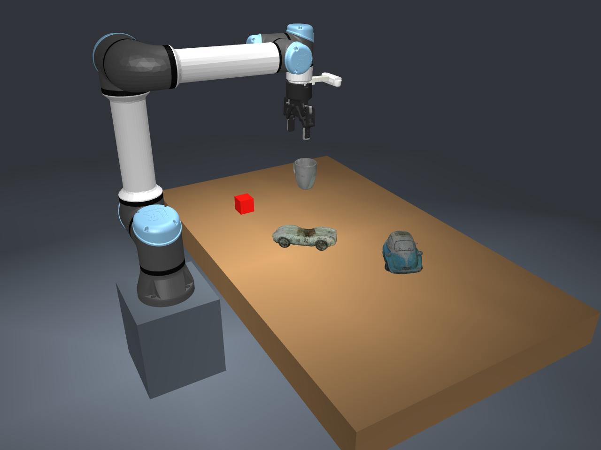
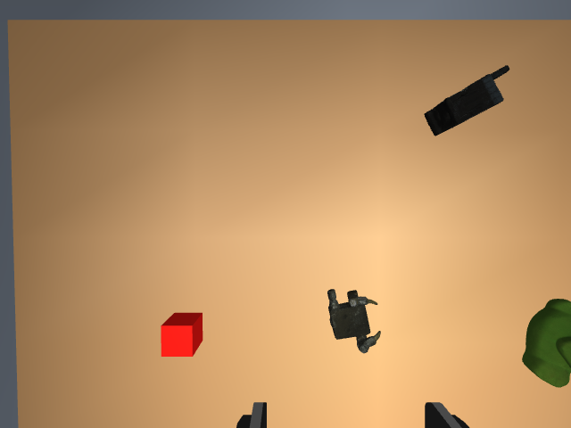

# UR5e tabletop RGB-D sandbox

This project runs a UR5e with a Robotiq 2F-85 gripper and a side-mounted RealSense D435i in MuJoCo. The camera looks along the gripper approach axis. A red cube and two or three HomebrewedDB objects appear on the table with their original colors.

## Simulation previews

Each scene randomly selects and places HomebrewedDB objects. These two reproducible examples each contain three dataset objects plus the red cube:

| Seed 7 | Seed 42 |
|:--:|:--:|
|  |  |

The 640×480 RGB image below is captured from the side-mounted RealSense D435i in the seed 7 scene. The capture script also writes metric depth for every pixel.



The camera is fixed to the end effector beside the gripper:


## Layout

- `examples/ur5e_eye_in_hand/` — scene builder, interactive viewer, RGB-D capture, and optional ZMQ subscriber.
- `examples/maniskill3/` — a separate ManiSkill PickCube experiment.
- `thirdparty/mujoco_menagerie/` — only the UR5e, 2F-85, and D435i model assets used here.
- `thirdparty/maniskill3/` — ManiSkill 3.0.1 package source and bundled assets.
- `docs/images/` — two tabletop scenes, an assembly view, and a camera frame.
- `videos/ms3_benchmark/` — existing ManiSkill benchmark recordings.

The Docker image has separate Python environments: `/root/miniconda3/bin/python` for MuJoCo and `/root/miniconda3/envs/maniskill/bin/python` for ManiSkill 3.0.1. The ManiSkill example can load the source copy under `thirdparty/maniskill3` through `PYTHONPATH`.

## Run the UR5e scene

Start from this directory. The HomebrewedDB mount is read-only:

```bash
HB_ROOT='/media/rafay/Windows-SSD/other/data/open_source/HB_HomebrewedDB_TUM'
docker run -it --rm --name vla_scenegraph_env --gpus all --ipc=host --network=host \
  -e DISPLAY="$DISPLAY" \
  -e NVIDIA_DRIVER_CAPABILITIES=compute,utility,graphics,display \
  -v /tmp/.X11-unix:/tmp/.X11-unix \
  -v "$PWD":/workspace -v "$HB_ROOT":/datasets/homebrewed:ro \
  -w /workspace -d vla_scenegraph_env:v01
```

With the container running, open the scene or the live camera view:

```bash
docker exec -it vla_scenegraph_env /root/miniconda3/bin/python \
  /workspace/examples/ur5e_eye_in_hand/view.py --camera overview
docker exec -it vla_scenegraph_env /root/miniconda3/bin/python \
  /workspace/examples/ur5e_eye_in_hand/view.py --camera wrist
```

Capture one 640×480 RGB-D frame:

```bash
docker exec vla_scenegraph_env /root/miniconda3/bin/python \
  /workspace/examples/ur5e_eye_in_hand/run.py --frames 1 --seed 7 --hb-count 3
```

Generated frames and converted object meshes go under `outputs/`; this directory is disposable and can be regenerated from the read-only dataset. See [the example guide](examples/ur5e_eye_in_hand/README.md) for gripper controls, camera close-ups, and ZMQ streaming.

## Run the ManiSkill example

The bounded smoke check uses the ManiSkill environment and the vendored source:

```bash
docker exec -e PYTHONPATH=/workspace/thirdparty/maniskill3 vla_scenegraph_env \
  /root/miniconda3/envs/maniskill/bin/python \
  /workspace/examples/maniskill3/parallel_in_single_scene.py --num-envs 2 --steps 2
```

Add `--render --steps 0` for the interactive viewer. See [the ManiSkill example guide](examples/maniskill3/README.md).
